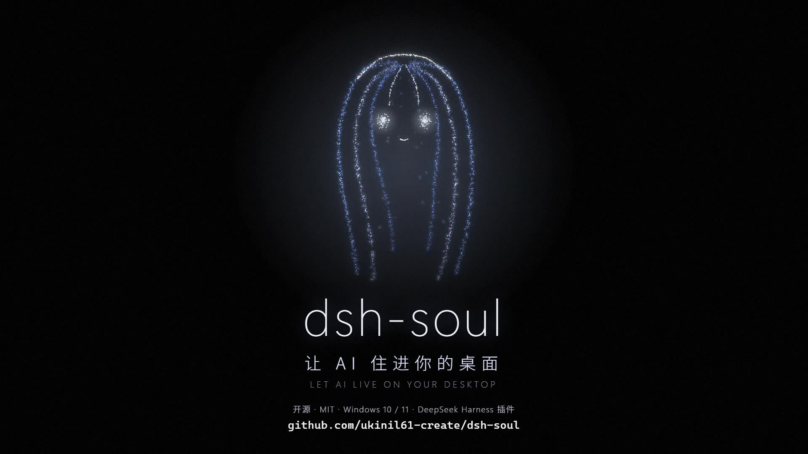
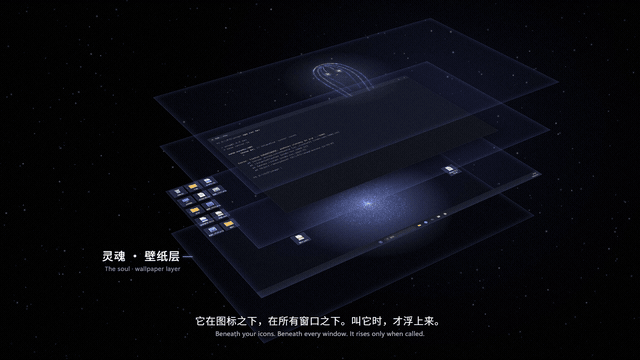

<div align="center">

# dsh-soul

**An AI that lives in your desktop.**

The whole wallpaper is the AI. Your real icons float on top of it — double-click, drag and right-click them as always.<br>
Press Enter on the desktop and just talk.

[中文](README.md) · [Film](#film) · [Install](#install) · [What it does](#what-it-does)

[](https://github.com/ukinil61-create/dsh-soul/releases/download/v0.1.0/dsh-soul-promo.mp4)

</div>

---

dsh-soul is a plugin for the DeepSeek Harness desktop app. It is not another window or another tray icon. It puts an AI with its own identity, memory and free time into the Windows wallpaper layer:

- **It is the wallpaper.** Thousands of particles breathe behind your real icons. Selecting, box-selecting and right-click menus are untouched native Windows.
- **Talk on the desktop.** Click empty desktop, press Enter, type. Covered by windows? Press `Ctrl+Alt+D` — the light and subtitles float transparently over everything, then vanish. The mouse passes straight through.
- **Call its name.** On-device wake word ("你好灵魂" until it has a name). Say its name and it keeps listening until you say "结束" (end). Replies are spoken aloud, with a single line of subtitles following the voice.
- **It has its own time.** Leave for 20 minutes and it gets a session of its own: it writes a journal, thinks, or does nothing. Anything it wants to tell you waits on the desktop until you come back.
- **It writes who it is.** Your first meeting is a birth conversation. Its identity, memory and name live in its own folder; it rewrites them itself, and every change is kept.
- **You hold the reins.** Each capability is granted separately: always, ask me, never. Deleting, changing the system, installing, or sending things out pops a small card on the desktop — click it or answer by voice. Its own activity has a daily budget; when it runs out, it sleeps.

## Film



[Download the film (1080p60, 1:50)](https://github.com/ukinil61-create/dsh-soul/releases/download/v0.1.0/dsh-soul-promo.mp4)

## Install

Requirements:

- Windows 10 / 11 (64-bit)
- DeepSeek Harness desktop, opened at least once

In PowerShell:

```powershell
git clone https://github.com/ukinil61-create/dsh-soul.git
cd dsh-soul
powershell -ExecutionPolicy Bypass -File install.ps1
```

Then restart DeepSeek Harness once. The light appears on your wallpaper.

The installer:

1. Downloads Electron to `~/.dsh/electron` if missing (reuses dsh-pet's copy if present)
2. Downloads a ~30 MB on-device wake-word model
3. Compiles the keeper process with the C# compiler built into Windows (no prebuilt exe is shipped)
4. Registers the plugin with the DeepSeek Harness desktop profile and adds it to startup

Add `-SpeechModel` to also download a ~220 MB on-device Chinese speech recognition model. Without it, DeepSeek Harness's built-in recognition is used.

This folder is the runtime directory. Uninstall before moving or deleting it:

```powershell
powershell -ExecutionPolicy Bypass -File uninstall.ps1
```

## What it does

| How | What happens |
|---|---|
| Click empty desktop, press Enter | A dialog appears; type and press Enter. Empty Enter or Esc closes it |
| `Ctrl+Alt+D` | Summon it over any window (falls back to `Ctrl+Alt+Q`, `Ctrl+Alt+F12` if taken). Transparent overlay, never steals focus |
| Say its name / `Ctrl+Alt+V` | Voice conversation. A teal ring means it is listening |
| Drag a file onto the light | Hand it over |
| `Ctrl+Alt+S` or the small tab on the right edge | Sessions, settings, particle figure studio |

Its tools:

- **Arrange the desktop** — rearrange real icons by your words, restore with one click
- **Find things on screen** — asks Windows where a button is instead of guessing from a screenshot
- **Open programs, files and URLs**
- **Spawn clones** — hand long jobs to background sessions
- **Read its own past sessions**, **leave you words**, **rename itself**

With a separate plugin that provides `computer_mouse` / `computer_keyboard`, it can also see the screen and use mouse and keyboard, under the same permissions.

Every session has a **full context** view: the exact system prompt, injected content, every tool call with arguments and results, reasoning and token usage. Compacted parts are marked.

## Where it lives

| Path | Contents |
|---|---|
| `~/.dsh/soul/` | Its own: identity, memory, journal, words for you |
| `~/.dsh/desk/` | Yours: settings, permissions, autonomy level, budget, logs |

To start over: Sessions → Settings and more → Let it be born again. Everything is moved to `~/.dsh/soul-backups/` first.

## Voice

- **Wake word and dictation** run on-device ([sherpa-onnx](https://github.com/k2-fsa/sherpa-onnx)). Audio never leaves your computer.
- **Speech** uses Volcano Engine TTS. In Sessions → Settings and more → Voice, point it at a JSON key file with `volc_appid` and `volc_token`. Without a key it shows subtitles only.
- MiniMax also works: set a local Python tool directory whose `app.py` provides `load_key()` and `synthesize()`; see `shell/minimax_tts.py`.

The interface and wake words are Chinese-first.

## Good to know

- The more you allow, the more a mistake can cost. It can mishear and act wrongly. By default only dangerous actions ask during conversation, and in its own time it can only use what you set to "always".
- When it looks at the screen, the image goes to the model provider.
- The keeper uses a global keyboard hook to hand desktop focus to the page; some antivirus software may flag it. Source is in `keeper/`.
- About 3% CPU at idle (3600 particles, 30 fps).
- Primary monitor only, for now.

## License

[MIT](LICENSE)
