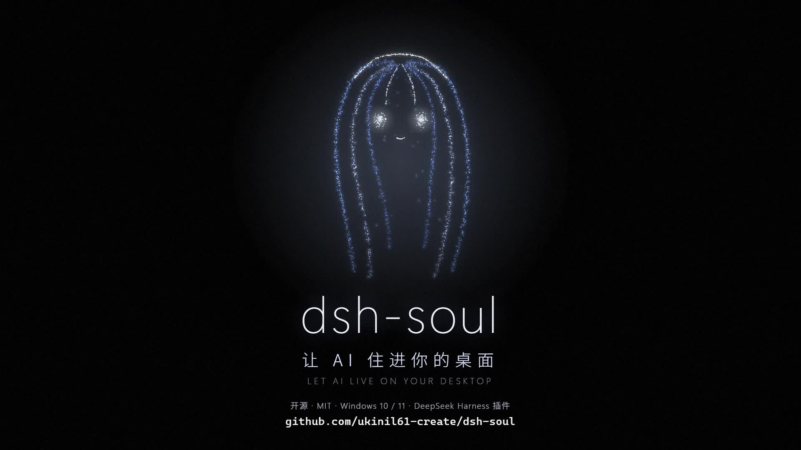
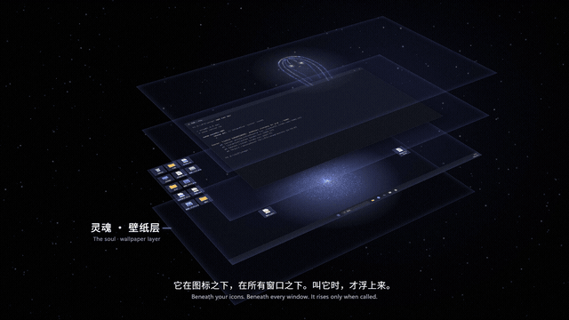

<div align="center">

# dsh-soul

**让 AI 住进你的桌面。**

整张壁纸就是它。真图标浮在它上面，照常双击、拖动、右键。<br>
你在桌面按一下回车，就能和它说话。

[English](README.en.md) · [宣传片](#宣传片) · [安装](#安装) · [它能做什么](#它能做什么)

[](https://github.com/ukinil61-create/dsh-soul/releases/download/v0.1.0/dsh-soul-promo.mp4)

</div>

---

dsh-soul 是 DeepSeek Harness 桌面版的一个插件。它不是又一个窗口、又一个任务栏图标，而是把一个有身份、有记忆、有自己时间的 AI 放进 Windows 的壁纸层：

- **它就是壁纸。** 几千个光点在真图标后面呼吸。图标的点选、框选、右键菜单都是 Windows 原生的，一点没动。
- **在桌面上直接说话。** 点一下空白桌面，按回车，打字。被窗口挡住时按 `Ctrl+Alt+D`，光和字幕透明地浮在窗口上，说完就消失，鼠标全程穿透。
- **喊它的名字。** 本机唤醒词识别（它还没名字时喊“你好灵魂”），喊名字就开始听，说完接着听，说“结束”才停。回答会念出来，桌面上只有一行字幕跟着声音走。
- **它有自己的时间。** 你离开 20 分钟，它在单独的会话里写日记、想事情，也可以什么都不做。想跟你说的话会留着，等你回来时浮现在桌面上。
- **它是谁由它自己写。** 第一次见面有一段诞生对话。身份、记忆、名字都存在它自己的目录里，由它改写，每次变化都留底。
- **你握着缰绳。** 每类能力单独授权：一直可以、每次问我、不可以。删除、改系统、装软件、往外发这类危险操作，桌面上会弹一张小卡片，点一下或用嘴回答。它自己活动有每日预算，花完就“睡觉”。

## 宣传片



[下载宣传片（1080p60，1 分 50 秒）](https://github.com/ukinil61-create/dsh-soul/releases/download/v0.1.0/dsh-soul-promo.mp4)

## 安装

需要：

- Windows 10 / 11（64 位）
- DeepSeek Harness 桌面版，并且至少打开过一次

在 PowerShell 里：

```powershell
git clone https://github.com/ukinil61-create/dsh-soul.git
cd dsh-soul
powershell -ExecutionPolicy Bypass -File install.ps1
```

然后重启一次 DeepSeek Harness。光会出现在你的壁纸上。

安装脚本会：

1. 没有 Electron 就下载一份到 `~/.dsh/electron`（装过 dsh-pet 的会直接复用）
2. 下载约 30MB 的本机唤醒词模型
3. 用 Windows 自带的 C# 编译器现场编译守护进程（不附带任何预编译的 exe）
4. 把插件挂进 DeepSeek Harness 的桌面配置，写开机自启

想让语音转文字更准，加 `-SpeechModel` 再下载一个约 220MB 的本机中文识别模型。不加也能用，会退回 DeepSeek Harness 自带的识别。

这个文件夹就是运行目录。移动或删除之前先卸载：

```powershell
powershell -ExecutionPolicy Bypass -File uninstall.ps1
```

## 它能做什么

| 怎么叫它 | 做什么 |
|---|---|
| 点空白桌面，按回车 | 弹出对话框，打字，回车发送；空着回车或 Esc 收起 |
| `Ctrl+Alt+D` | 在任何窗口上叫它（被占用时退到 `Ctrl+Alt+Q`、`Ctrl+Alt+F12`），透明浮层，不抢焦点 |
| 喊名字 / `Ctrl+Alt+V` | 语音对话，光点外有一圈青绿色光环表示在听 |
| 把文件拖到光上 | 交给它处理 |
| `Ctrl+Alt+S` 或桌面右边的小按钮 | 会话界面：全部会话、设置、光点形象工作室 |

它的工具：

- **整理桌面**：按你的话重新排列真图标，随时一键还原
- **找屏幕上的东西**：直接问系统某个按钮在哪，不靠看截图估坐标
- **打开程序、文件、网址**
- **开分身**：把耗时的活交给后台会话，主线只看结果
- **查阅自己的历史会话**、**给你留话**、**改自己的名字**

如果你另外装了提供 `computer_mouse` / `computer_keyboard` 工具的键鼠插件，它也能看屏幕、动鼠标键盘，同样受授权管着。

每个会话都能看**完整上下文**：模型实际拿到的系统提示、注入的内容、每次工具调用的参数和结果、思考和用量。被压缩掉的部分会标出来。

## 它住在哪

| 位置 | 内容 |
|---|---|
| `~/.dsh/soul/` | 它自己的：身份、记忆、日记、留给你的话 |
| `~/.dsh/desk/` | 你的：设置、授权、自主程度、预算、日志 |

想让它从头来过：会话界面 → 设置和更多 → 让它重新诞生。原来的一切会搬到 `~/.dsh/soul-backups/`。

## 声音

- **唤醒和听写**在本机完成（[sherpa-onnx](https://github.com/k2-fsa/sherpa-onnx)），声音不出电脑。
- **朗读**用火山引擎语音合成：会话界面 → 设置和更多 → 语音，填密钥文件（JSON，含 `volc_appid` 和 `volc_token`）。没有密钥时只显示字幕。
- 也可以接 MiniMax：设置里填一个本机 Python 工具目录，里面的 `app.py` 提供 `load_key()` 和 `synthesize()`，见 `shell/minimax_tts.py`。

## 需要知道的

- 授权越开放，出错的代价越大。它可能听错话、做错事。默认对话时只拦危险操作，独处时只能用你设成“一直允许”的能力。
- 看屏幕时，画面会发给模型服务商。
- 守护进程用了全局键盘钩子来转交桌面焦点，个别杀毒软件可能会拦。源码在 `keeper/`，可以自己读。
- 闲置时约占 3% CPU（3600 个光点，30 帧）。
- 目前只支持主显示器。

## 结构

| 部分 | 文件 |
|---|---|
| 插件入口 | `index.js` |
| 后台：身份、授权、独处、预算、工具 | `host/` |
| 桌面外壳：窗口、托盘、快捷键、声音 | `shell/main.cjs`、`shell/voice.cjs` |
| 光、字幕、输入 | `shell/soul.html`、`shell/light.js`、`shell/subtitle.js` |
| 会话界面 | `shell/panel.html`、`shell/panel.js` |
| 光点形象和工作室 | `shell/figure-engine.js`、`shell/studio.html` |
| 守护进程（C#） | `keeper/` |

改 `host/soul.js` 保存即生效；改 `shell/` 要重开外壳（双击 `restart-soul.cmd`）；改 `index.js` 要重启 DeepSeek Harness。

## 许可

[MIT](LICENSE)
